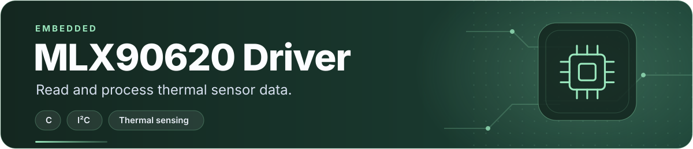

# 

A C driver with EEPROM, configuration, pixel capture, and temperature calculations. The inherited register map and calibration match the MLX90621 documentation. Compatibility with physical MLX90620 hardware remains unverified.

[](https://github.com/svazqz/mlx90620/actions/workflows/ci.yml)

[Quick start](#quick-start) · [Validation](#validation) · [Project layout](#project-layout)

## Quick start

Use Git, a C11 compiler, and Make. The first build initializes the pinned `soft_i2c` submodule.

```sh
make
```

The driver archive is `build/libmlx90620.a`. Build the bundled `soft_i2c` library with WiringPi installed on the Raspberry Pi. Link both archives into your app and initialize the bus with `setupI2C()`.

## Validation

```sh
make test
```

The tests simulate I²C and run without connected hardware. Coverage includes register transactions, signed pixel decoding, calibration, and invalid readings. Link with `-lm` when building a consuming application.

## Project layout

| Path | Purpose |
| --- | --- |
| [`include/`](include/) | Public C interface |
| [`src/`](src/) | Driver implementation |
| [`tests/`](tests/) | Mock-bus unit tests |
| [`soft_i2c/`](soft_i2c/) | Pinned GPIO-based I²C submodule |
